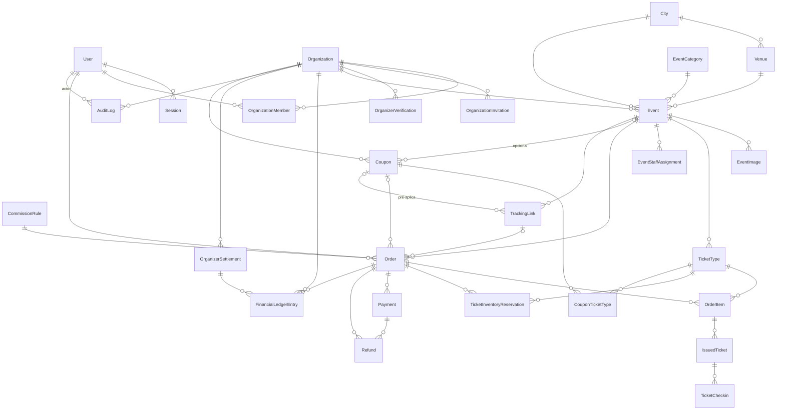

# Banco de dados

Responsável: agente `banco-de-dados` (único que altera `prisma/schema.prisma` e
`prisma/migrations/`). Stack: PostgreSQL 17, Prisma 7 (`prisma-client` gerado em
`src/generated/prisma`, adaptador `@prisma/adapter-pg`). Cliente da aplicação:
`createPrismaClient()` / `db` em `src/server/db.ts`.

Convenções: ids `cuid()`; dinheiro em **centavos inteiros** (`…Cents`);
percentuais em **pontos-base** (`…Bps`, 10000 = 100%); datas `timestamptz(3)`.

## Visão por domínio

| Domínio | Modelos | Dono (consultar antes de mudar) |
| --- | --- | --- |
| Identidade | `User` (`platformRole` USER/ADMIN, `isDemoAccount`), `Session` | `admin` (papéis/suspensão) |
| Organizações | `Organization`, `OrganizationMember` (`OrgRole`), `OrganizationInvitation`, `OrganizerVerification` (documento cifrado com `encryptPII`) | `area-organizador`; aprovação → `admin` |
| Catálogo | `City`, `Venue`, `EventCategory`, `Event`, `EventImage`, `TicketType` | `area-organizador` (eventos/lotes); `paginas-publicas` (cidades, categorias, busca) |
| Pedidos e estoque | `Order`, `OrderItem`, `TicketInventoryReservation` | `pagamentos-financeiro` |
| Cupons e atribuição (ADR 0002) | `Coupon`, `CouponTicketType`, `TrackingLink`; instantâneos em `Order` (`couponCode`, `discountCents`, `utm*`) e `OrderItem` (`listUnitPriceCents`, `discountPerUnitCents`) | Cadastro → `area-organizador`; preço, contadores e reconciliação → `pagamentos-financeiro` |
| Pagamentos | `Payment`, `PaymentWebhookEvent`, `SimulatedProviderPayment` (só provedor simulado) | `pagamentos-financeiro` |
| Ingressos e entrada | `IssuedTicket`, `TicketCheckin`, `EventStaffAssignment` | `check-in` |
| Financeiro | `Refund`, `CommissionRule`, `FinancialLedgerEntry`, `OrganizerSettlement` | `pagamentos-financeiro` |
| Auditoria | `AuditLog` (gravado por `audit()` em `src/server/audit.ts`) | `admin` |

Unicidades que sustentam regras de negócio (não remover sem falar com o dono):
`Order(userId, idempotencyKey)`, `Payment(provider, providerPaymentId)`,
`PaymentWebhookEvent(provider, externalEventId)` (deduplicação de webhook),
`IssuedTicket(orderItemId, sequence)` (emissão única),
`FinancialLedgerEntry(idempotencyKey, account, direction)`,
`OrganizationMember(organizationId, userId)`, `EventStaffAssignment(eventId, userId)`,
`Coupon(organizationId, code)`, `TrackingLink(code)`.

**Mesmo tenant por FK composta.** `Event @@unique([id, organizationId])` e
`Coupon @@unique([id, organizationId])` existem para que
`Coupon(eventId, organizationId)`, `TrackingLink(eventId, organizationId)` e
`Order(couponId, organizationId)` só apontem para registros da mesma
organização. Essas FKs são `Restrict`: com `organizationId` obrigatório, um
`SetNull` composto tentaria anular a organização. Ficam no serviço (e na
reconciliação): `TrackingLink.couponId` da mesma organização,
`Order.trackingLinkId` do mesmo evento e `CouponTicketType` com tipos do evento
do cupom. Cupom ou link usado não se apaga (`Restrict` a partir de `Order`);
desative com `disabledAt`/`archivedAt`.

## Objetos SQL escritos à mão

O Prisma não modela os objetos abaixo. Eles vivem só nas migrações e são
verificados pelos testes de integração. `prisma migrate diff` e
`prisma migrate dev` **não** tentam removê-los (verificado: diff vazio entre um
banco migrado e o schema).

| Objeto | Migração | Garante |
| --- | --- | --- |
| `TicketType_no_oversell`, `_counters_nonnegative`, `_refunds_le_sold`, `_price_nonnegative`, `_order_limits` | `20261026001232_integrity_constraints` | Sem overselling (`reservado + vendido ≤ total`), contadores e preço não negativos |
| `Event_capacity_positive`, `_time_order`, `_half_price_quota`, `_age` | idem | Datas coerentes, cota de meia 0–10000 bps, idade 0–21 |
| `Reservation_quantity_positive`, `Order_amounts_nonnegative` (`total = subtotal + taxa`), `OrderItem_amounts`, `Payment_amount_nonnegative`, `Refund_amount_nonnegative` | idem | Valores monetários válidos |
| `CommissionRule_bps`, `CommissionRule_scope_target` | idem | Percentual válido; escopo PLATFORM/ORGANIZATION/EVENT com o alvo certo |
| `Ledger_amount_positive` | idem | Lançamentos do razão > 0 |
| Gatilho `FinancialLedgerEntry_immutable` (`ledger_block_mutation()`) | idem | Razão somente inserção |
| Índice `Event_title_lower_idx` (`lower(title)`) | idem | Busca por título sem diferenciar maiúsculas |
| Gatilho `AuditLog_immutable` (`audit_log_block_mutation()`) | `20261026150000_audit_log_append_only` | Auditoria somente inserção |
| `Coupon_counters_nonnegative`, `_max_uses`, `_discount_value`, `_validity`, `_code_format` | `20261027120000_coupons_tracking_links` | Contadores ≥ 0 (pega decremento duplo); limites > 0; `PERCENT` com 1–10000 bps **ou** `FIXED_PER_TICKET` com valor > 0; janela coerente; código `^[A-Z0-9_-]{3,32}$`. O limite de usos **não** é CHECK (pagamento tardio pode ultrapassá-lo, auditado). |
| `TrackingLink_clicks_nonnegative`, `_code_format` | idem | Cliques ≥ 0; código `^[A-Za-z0-9]{6,16}$` |
| `OrderItem_discount` | idem | `unitPriceCents = listUnitPriceCents - discountPerUnitCents`, desconto ≥ 0 (com `unitPriceCents >= 0`, desconto ≤ preço de tabela) |
| `Order_discount` | idem | Desconto ≥ 0 e só com cupom; `couponId` e `couponCode` preenchidos juntos. `discountCents = Σ itens` fica na reconciliação. |

Os dois gatilhos são `BEFORE UPDATE OR DELETE … FOR EACH ROW`:

- `TRUNCATE` não os aciona. A limpeza do seed e dos testes (`resetDb` em
  `tests/support/fixtures.ts`) continua funcionando.
- Corrigir um lançamento ou registro de auditoria é sempre um **novo** registro
  (estorno/ajuste), nunca uma edição.
- As FKs `AuditLog.actorUserId` e `AuditLog.organizationId` são
  `ON DELETE SET NULL`. Esse `SET NULL` é um UPDATE e é bloqueado, então
  **excluir um `User` ou `Organization` que aparece na auditoria falha**. Hoje
  nenhum código exclui usuários ou organizações. Para LGPD, desative ou
  anonimize o registro em vez de excluí-lo (política a definir com o `admin`).

## Ambiente local

Pré-requisitos: Node 24, `npm ci`, `.env` copiado de `.env.example` (nunca versionar).

| Opção | Comando |
| --- | --- |
| Docker | `docker compose up -d` (porta 5433, volume `pgdata`, health check) |
| Sem Docker | `npm run db:start` (PostgreSQL embutido; dados em `os.tmpdir()/evento-brasil-pgdata/<porta>`; recusa `NODE_ENV=production`) |
| Windows, um clique | `INICIAR-EVENTO-BRASIL.bat` |

| Script | O que faz |
| --- | --- |
| `npm run db:status` | Somente leitura: mostra `usuário@host:porta/banco` (sem senha), testa a conexão e roda `prisma migrate status`. Sai com 1 se não conectar ou houver migração pendente. |
| `npm run db:migrate -- --name <descricao>` | `prisma migrate dev`: cria e aplica migração no banco **local** |
| `npm run db:deploy` | `prisma migrate deploy`: aplica migrações pendentes, sem criar novas |
| `npm run db:seed` | Dados de demonstração (ver abaixo) |
| `npm run db:reset -- --yes` | **Apaga** o banco local, reaplica as migrações e roda o seed (`--no-seed` para pular). Recusa `NODE_ENV=production`, host que não seja `localhost`/`127.0.0.1`/`::1` e execução sem `--yes`. |
| `npm run db:generate` | Gera o cliente Prisma (também roda no `postinstall`) |
| `npx tsx --conditions=react-server scripts/db-summary.ts` | Resumo de pedidos, ingressos, reembolsos e razão |

## Banco de testes

`npm test` sobe um PostgreSQL **descartável** (embutido, porta `TEST_DB_PORT`,
padrão 5434), aplica `prisma migrate deploy` e o apaga no final
(`tests/support/global-setup.ts`). Com `TEST_DATABASE_URL` definido, usa esse
banco como está e o limpa com `TRUNCATE`, então aponte-o só para um banco
descartável. Os testes de integração (`tests/integration/`) usam o banco real,
inclusive a concorrência (overselling, último ingresso, webhook duplicado,
check-in simultâneo, reembolso × check-in) e `checkFinancialInvariants`.

## Seed de demonstração

`prisma/seed.ts` cria as 27 capitais + Franca, categorias, contas
`…@demo.eventobrasil.test` (senha em `DEMO_PASSWORD`), organizações, eventos,
pedidos pagos pelo provedor simulado, um check-in e um reembolso, sempre pelos
**serviços reais**. Também cria o cupom `DEMO10` (10% na Noite de Samba, só nos
tipos que não são meia-entrada) e o link rastreado `demoSamba1` (UTMs de
Instagram, pré-aplica o `DEMO10`). Até o passo 2 do ADR 0002 eles não alteram
preço.

- Recusa `NODE_ENV=production`.
- Se `admin@demo.eventobrasil.test` já existe, informa que o banco já tem o seed
  e sai com código 0, sem alterar nada. Rodar duas vezes é seguro.
- Se o banco tem usuários, organizações ou pedidos que não são do seed, recusa
  com código 1. O seed começa com `TRUNCATE` de todas as tabelas e destruiria
  esses dados.
- Num banco sem dados de uso, o `TRUNCATE` inicial também apaga tabelas de
  referência (ex.: cidades de `npm run cities:import`). Importe as cidades
  depois do seed.
- Para recriar do zero: `npm run db:reset -- --yes`.

## Procedimento de migração

1. Leia o schema e o histórico em `prisma/migrations/`. **Nunca edite uma
   migração já aplicada**: crie uma nova.
2. Combine mudanças de contrato com o dono do domínio (tabela acima).
3. Altere `schema.prisma` → `npx prisma format` → `npx prisma validate`.
4. `npm run db:migrate -- --name <descricao>` no banco local. Para SQL que o
   Prisma não expressa (CHECK, gatilho, índice por expressão), use
   `--create-only`, edite o `migration.sql` gerado e aplique com `db:migrate`.
5. Revise o SQL: nada de `DROP` de objetos da tabela acima. Prefira
   expandir-e-contrair (adicionar coluna → preencher → trocar leitura →
   remover depois) a dropar e recriar. A migração
   `20261026001710_processing_fee_bearer` dropou e recriou uma coluna, que é o
   caso a evitar.
6. `npm run db:generate`, `npm run typecheck`, `npm test` (aplica tudo num banco
   descartável) e `npm run build`.
7. Em produção, só `prisma migrate deploy`, com backup prévio, aprovação e
   plano de recuperação. Nunca `migrate dev`, `db:reset` ou seed.
